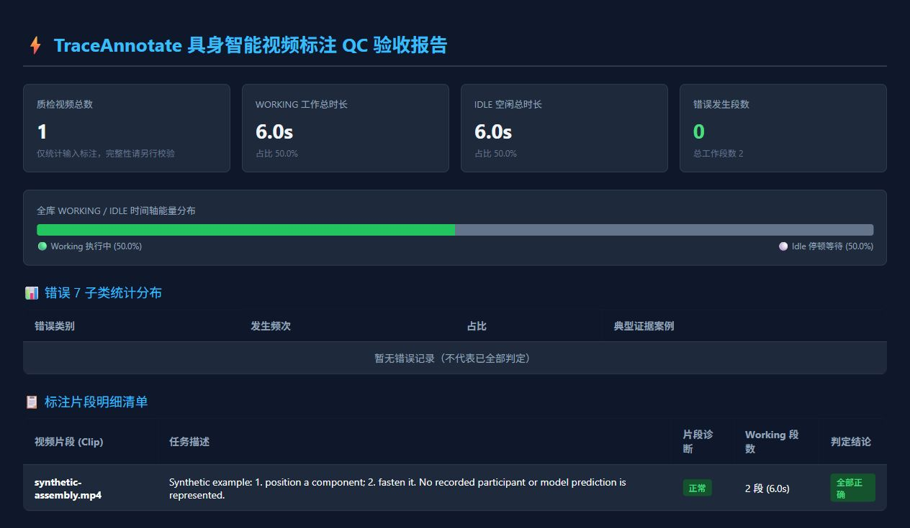

# TraceAnnotate

面向本地媒体复核与视频时序标注的 Python 工具集。

[](https://github.com/wyregey779-dot/trace-annotate/actions/workflows/ci.yml)
[](LICENSE)

[English](README.md) · [中文说明](README_CN.md) · [快速上手](docs/QUICKSTART.md) · [版本发布](https://github.com/wyregey779-dot/trace-annotate/releases)

TraceAnnotate 提供本地媒体复核与视频时序标注。开发版新增通用片段模式，支持自由事件标签、文字描述、标签词、多轨道与重叠事件；具身流程继续提供 working/idle、步骤检查与对错判定。Python 库还提供媒体分批暂存、字段来源记录与资产复核辅助功能。

## 普通视频片段标注（开发版）

新功能位于 `1.1.0.dev0`，下文已发布的 `v1.0.2` 尚不包含。请在当前源码目录安装 `python -m pip install -e ".[dev]"`，然后运行：

```bash
trace-annotate video-ui
trace-annotate video-open input.mov -o new-annotation-project
trace-annotate video-validate examples/annotations/general-video.json
trace-annotate video-export examples/annotations/general-video.json --format srt --track "字幕" -o output-subtitles.srt
```

选择本地视频后，可以创建片段、修改时间和标签、按轨道组织事件，并下载 JSON 供下次继续编辑。多个事件可以同时发生，不会被自动解释为工作段或判定对错。JSON 是完整主文件；CSV、SRT 和 WebVTT 是表格或字幕投影，不能完整保留所有字段。新命令拒绝覆盖已有输出。详见[通用视频标注指南](docs/GENERAL_VIDEO_ANNOTATION.md)，包含字幕导入、草稿恢复、格式限制与后续框选/跟踪计划。

新页面使用 v2 文档，把标注和草稿绑定到完整媒体 SHA-256；后台 Worker 本地分块计算，可以取消。同名、同大小、同时长但内容不同的视频会被拒绝。旧 v1 文档需确认迁移并重新复核；同内容改名后可重新关联。命令行提供 `video-hash` 与 `video-bind`。页面分别显示呈现帧时间戳和秒级播放位置，准确逐帧导航仍待实现。

浏览器不能直接播放 ProRes、AVI、TS 或其他本地格式时，使用 `video-open 原片 -o 新项目目录`。它调用本机 FFmpeg/ffprobe 准备 H.264/AAC 兼容副本，逐帧核对时间对应、保留原片身份与音轨偏移，再自动打开编辑器。继续编辑使用 `video-ui --project 项目目录` 并导入上次下载的 JSON。HDR 预览需显式添加 `--tone-map-hdr`；损坏、加密或无法可靠解码的文件会明确失败。详见[跨格式兼容指南](docs/MEDIA_COMPATIBILITY.md)。

## 从一个完整示例开始

快速上手示例依次完成 idle 计算、记录校验、步骤对账、HTML 报告和 SRT 导出。使用合成标注数据，无需视频文件、模型权重或 API 密钥。

```bash
git clone --branch v1.0.2 --depth 1 https://github.com/wyregey779-dot/trace-annotate.git
cd trace-annotate
python -m venv .venv
```

PowerShell 使用 `.venv\Scripts\Activate.ps1` 激活环境，Linux/macOS 使用 `source .venv/bin/activate`，然后执行：

```bash
python -m pip install .
python examples/run_quickstart.py --output output/quickstart
```

预期最后输出：

```text
Verified: 2 working segments, 3 idle intervals, 5 subtitle entries.
```

打开 `output/quickstart/qc-report.html` 查看报告。同一目录中还会生成处理后的 `assembly.json` 和 `assembly.srt`。脚本拒绝写入已存在的输出目录；再次运行时请换一个新路径。



截图来自该示例生成的实际报告。标签是用于展示记录格式的合成数据，不是模型预测。[完整教程](docs/QUICKSTART.md)包含逐条命令、预期间隔和常见问题处理。

## 当前功能

| 领域 | 功能 | 状态与范围 |
| --- | --- | --- |
| 媒体准备 | 分批暂存、源/暂存目录边界检查、使用中锁定、文件大小与前 1 MiB MD5 校验 | 本地文件系统操作，有回归测试 |
| 资产复核 | 亮度/清晰度指标、dHash 聚类、可配置规则与拼图 | 辅助复核；标签仍需人工判断 |
| 来源记录 | 字段级 `fill` 来源、人工覆写、修订历史与回滚 | Python 库 |
| 通用片段 | 自由标签、文字、标签词、重叠多轨、复核状态、本地编辑器与 JSON/CSV/SRT/WebVTT | 开发版；尚无目标框和跟踪编辑界面 |
| 具身标注 | 浏览器编辑器、working/idle 补集、步骤对账、区间校验与采样一致性评估 | 独立命令与数据规则 |
| 报告与交换 | HTML 质检、SRT、Label Studio 配置/解析、CVAT 风格 XML、动作标签文本 | 有本地格式测试；外部软件及版本兼容性仍需往返验证 |
| 可选视觉/OCR | 运动、人脸、OCR 和场景辅助接口 | 需要相应运行时、可执行文件或本地模型 |
| CLIP 推理 | 规划中；适配器返回 `not_run` | 尚未实现完整图像/文本推理 |

## 安装发行版

使用 Python 3.9 或更新版本，核心依赖为 NumPy、Pillow 和 tqdm。不需要源码目录时，可在虚拟环境中安装固定版本源码包：

```bash
python -m pip install "https://github.com/wyregey779-dot/trace-annotate/archive/refs/tags/v1.0.2.zip"
trace-annotate --version
trace-annotate --help
```

核心时间轴处理在本地执行，无需 OpenAI API 密钥。安装及可选模型包可能需要网络；离线使用前请准备好依赖与权重。

参与开发时，在源码目录执行 `python -m pip install -e ".[dev]"`，具体流程见[贡献指南](CONTRIBUTING.md)。

## 标注和复核自己的视频

```bash
trace-annotate embodied-ui
```

选择浏览器支持的本地视频，标记区间，填写步骤编号并复核判定，然后导出 JSON。新建区间默认为 **无法判断**。选择其他视频会重置编辑器中的标注，请先导出当前工作。

使用命令行处理导出的记录：

```bash
trace-annotate embodied-validate clip.json
trace-annotate embodied-diff clip.json --nsteps 5
trace-annotate embodied-qc clip.json -o qc-report.html
trace-annotate embodied-export clip.json --format srt -o clip.srt
```

需要重新计算 idle 时，执行 `trace-annotate embodied-idle clip.json --duration 60`，把时长改成视频真实秒数。默认打印生成的 JSON；只有准备覆盖文件时才添加 `--inplace`。保留真实总时长才能包含末尾空闲区间。

字段与标签约定见[标注 SOP](docs/EMBODIED_ANNOTATION_SOP.md)。`examples/` 内另外两个脚本分别用合成数据演示资产处理与时间轴一致性。资产示例使用模拟人脸/CLIP 字段，并会创建、删除 `examples/_demo_scratch`。

## 可选依赖

在源码目录中按实际需要安装：

| 命令或依赖 | 用途 |
| --- | --- |
| `python -m pip install -e ".[cv]"` | OpenCV 视频/运动处理与可选 HEIF 支持；YuNet 人脸检测还需要兼容的本地 ONNX 权重 |
| `python -m pip install -e ".[ocr]"` | RapidOCR 接口，模型与运行时取决于实际安装的包 |
| `PATH` 中的 `ffmpeg` 可执行文件 | 场景切分辅助工具；pip 不会安装该可执行文件 |

`clip` 扩展安装 PyTorch/torchvision，但不提供 `cn_clip`、模型权重或完整推理实现。`full` 扩展用于安装可选依赖，不会改变这一限制。后续实现条件见 [CLIP 路线图](docs/ROADMAP.md#clip-inference)。

## 验证与当前限制

[CI](https://github.com/wyregey779-dot/trace-annotate/actions/workflows/ci.yml) 构建发行包、在源码目录外检查安装后的命令行与内置资源、运行回归测试和示例。测试矩阵覆盖 Windows、Linux 与 Python 3.9、3.11、3.13。[版本说明](https://github.com/wyregey779-dot/trace-annotate/releases)记录各版本实际执行的检查。

- 项目处于早期阶段。测试与合成数据验证具体行为，尚无公开证据确立大规模采用、模型准确率或规模化性能。
- 暂存清理会删除暂存副本，应使用专用目录并保留源文件备份。复制校验覆盖文件大小与前 1 MiB，不是全文件校验，也不是硬件写保护，无法防御所有并发文件系统改动。
- 采样时间轴一致性不等于语义标签质量。复核规则与阈值需要人工解释。
- 仓库中的 Label Studio “v2.1” 是本项目的标注约定，不是 Label Studio 官方产品版本。外部工具的兼容版本将随往返验证逐步记录。

## 文档与贡献

- [快速上手与预期输出](docs/QUICKSTART.md)
- [架构](docs/ARCHITECTURE.md)
- [标注 SOP](docs/EMBODIED_ANNOTATION_SOP.md)
- [资产 Schema 与字段来源](docs/PROVENANCE_SCHEMA.md)
- [视觉复核工作流](docs/FAST_AUDIT_WORKFLOW.md)
- [路线图与验收条件](docs/ROADMAP.md)
- [贡献指南](CONTRIBUTING.md) · [安全问题报告](SECURITY.md) · [更新记录](CHANGELOG.md)

通过 [GitHub Issues](https://github.com/wyregey779-dot/trace-annotate/issues) 报告可复现问题或提出具体改进，请附命令、项目/Python/系统版本、预期结果与最小合成数据。标注边界情况、外部格式往返检查、文档纠错都适合作为初次贡献。

## 许可证

[MIT](LICENSE)。外部模型权重、可选运行时和数据集可能使用各自的许可证。
