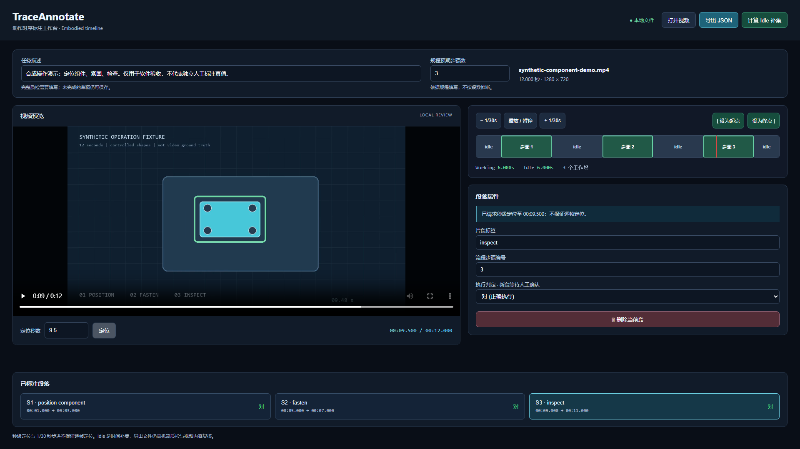
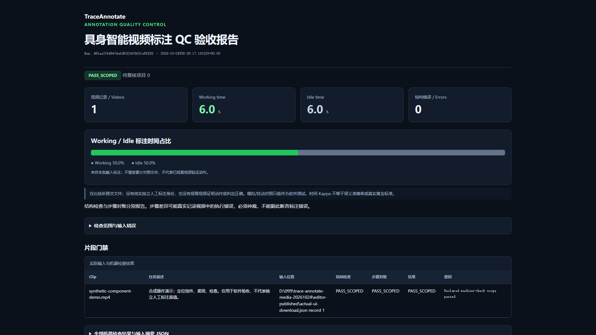

# Browser screenshots and operation recording

These assets show the development version of the embodied editor. The general
video editor remains a separate workflow with free event labels and overlapping
tracks; see [general video annotation](GENERAL_VIDEO_ANNOTATION.md).

| Asset | Origin |
| --- | --- |
| [Editor screenshot](media/embodied-editor.png) | Actual Chromium page after selecting local media, creating three intervals and downloading JSON |
| [QC screenshot](media/embodied-qc.png) | Actual HTML produced by `embodied-pipeline` from that browser download |
| [12-second operation recording](media/embodied-demo.mp4) | Actual browser recording, accelerated at the speed printed in the video; no voiceover |
| [Cover](media/traceannotate-cover.png) | Promotional design; it does not represent a product screenshot |

The [downloaded annotation](media/embodied-example.json) and [asset/source
hashes](media/provenance.json) accompany these captures. The 12-second cut
includes normal editing, error/cancellation checks and the actual QC page.





The input video is a generated 12-second geometric operation fixture, visibly
marked as synthetic. The scripted intervals are 1–3, 5–7 and 9–11 seconds;
their labels are `position component`, `fasten` and `inspect`. The procedure
declares three steps independently of the editor's segment count. The script
explicitly selects each verdict; new segments start as `无法判断`.

The downloaded JSON contains 6.0 seconds of working intervals and 6.0 seconds
of idle intervals. These totals come from the actual exported document. A
zero structural-error count describes the machine checks of that document;
it does not certify semantic accuracy or independent human annotation.

## Reproduce

Install the checkout and Chromium in a dedicated environment, with FFmpeg and
ffprobe on `PATH` (including the `libx264` encoder):

```bash
python -m pip install ".[dev,browser-test]"
python -m playwright install chromium
python -B scripts/check_embodied_editor.py --output output/embodied-demo-new
```

Use a new output directory every time. The script retains the synthetic input,
real downloaded annotations, command arguments, exit codes, logs, screenshots,
raw browser recording and SHA-256 inventory. It tests reversed/overlapping
interval rejection, cancelled/invalid media replacement, draft preservation,
strict QC failure for missing task descriptions, and a narrow viewport.

The browser runs in isolated headless Chromium and uses its actual file-input
control. This does not test a native operating-system file picker or a user
browser profile. Screenshots and the demo are operation evidence for this
synthetic fixture; review real footage separately.
